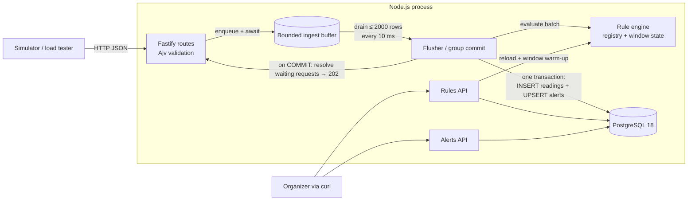
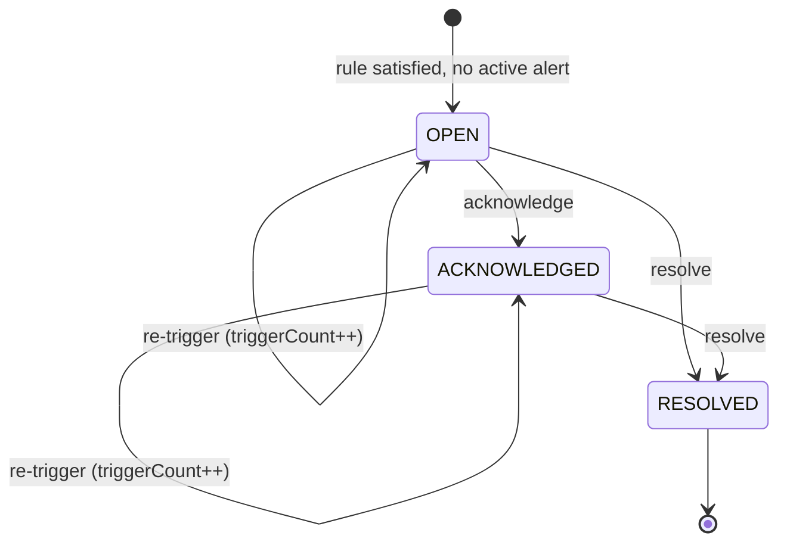

# design.md — Campus Sensor Monitoring & Alerts

> **How** the system satisfies `specs.md`. Section references such as FR-3 point to specs.md.

---

## 1. Technology choices

What's on the development machine (checked 2026-10-16):

| Found | Status / use |
|---|---|
| Node.js v24.12, npm 11, pnpm 11 | Runtime and package manager |
| PostgreSQL 18, native Windows service `postgresql-x64-18` on :5432 | **The database** (main + test DBs) |
| Docker Desktop 29.8 (14 CPU, 8 GB); images `redis:7-alpine`, `postgres:16`, … | Available but **not used**. PostgreSQL alone provides the durability guarantee (§9) |
| git 2.52, Python 3.12, Java 25 | git for version control |
| Kafka, k6 | Not installed, not needed |

| Concern | Choice | Why |
|---|---|---|
| Language/runtime | **TypeScript on Node.js 24** | Installed. Event loop suits I/O-bound ingestion. One language for the service, simulator and load test. |
| Package manager | **pnpm** | Installed. |
| HTTP framework | **Fastify 5** | Fastest mainstream Node framework, with compiled Ajv validation and JSON serialization. |
| Schemas | **TypeBox** | One definition → TS types + Ajv validation. |
| Database | **PostgreSQL 18 (native)** | Already running. Built-in `uuidv7()`, fast `unnest` bulk inserts, partial unique indexes, transactional commit = durability. |
| DB driver | **`pg`** (node-postgres) `Pool` | Mature, supports array parameters. |
| Migrations | Plain SQL files + tiny runner | No extra tool. |
| Tests | **Vitest** + `fastify.inject`, against a local test DB `campus_sensors_test` | Fast, TS-native, real-DB integration. |
| Simulator HTTP client | **undici** | Node's native fast client with keep-alive pooling. |
| Load generator | The project's simulator (`runBurst`, undici) | k6 isn't installed. The simulator sends exactly N distinct readings in any shape, so autocannon was not needed. |
| Lint/format | ESLint (typescript-eslint) + Prettier | |
| Dev runner | `tsx` (dev), `tsc` build (prod and load test) | |

---

## 2. Architecture overview



### Ingestion path: reply-after-commit ("group commit")
1. The request is validated. Its valid readings are queued **as one unit**, together with the request's resolve/reject callbacks.
2. The flusher drains whole requests, up to `FLUSH_MAX_ROWS` readings in total.
3. The flusher evaluates the batch, which produces readings and alert upserts.
4. In **one transaction** it inserts the readings and upserts the alerts, then commits.
5. On commit, it resolves every request whose readings were in the batch → `202`.

A `202` therefore means the reading and its alerts are durably stored (NFR-3). A request is never split across transactions, so it either fully succeeds (`202`) or fully fails (`503`, nothing stored). Throughput still comes from batching: one commit serves thousands of readings, and the extra cost is a few tens of ms of latency per request.

## 3. Repository layout

```
Task1_GDG/
├─ specs.md  design.md  tasks.md  README.md
├─ package.json  tsconfig.json  .env.example  vitest.config.ts
├─ src/
│  ├─ server.ts            # bootstrap, graceful shutdown
│  ├─ app.ts               # buildApp() — used by server and tests
│  ├─ config.ts
│  ├─ db/                  # pool.ts, migrate.ts, migrations/001_init.sql
│  ├─ ingest/              # schemas.ts, routes.ts, buffer.ts, pipeline.ts (flusher), repository.ts
│  ├─ rules/               # schemas.ts, routes.ts, repository.ts, registry.ts
│  ├─ common/              # errors.ts (HttpError -> specs §8 shape), ajv.ts (strict/coercing validators)
│  ├─ engine/              # engine.ts (facade), operators.ts, window.ts, evaluator.ts, warmup.ts
│  └─ alerts/              # schemas.ts, routes.ts, repository.ts
├─ simulator/              # index.ts (CLI), run.ts, patterns.ts, sender.ts
├─ loadtest/               # run.ts (harness), seed-rules.ts, report.ts, probe.mjs
├─ test/unit/  test/integration/
└─ docs/ARCHITECTURE.md  docs/LOAD_TEST_REPORT.md
```

## 4. Configuration (`.env`)

| Var | Default | Purpose |
|---|---|---|
| `PORT` | `3000` | HTTP port |
| `DATABASE_URL` | `postgres://postgres:<password>@localhost:5432/campus_sensors` | Main DB |
| `TEST_DATABASE_URL` | `…/campus_sensors_test` | Integration tests |
| `PG_POOL_MAX` | `10` | Pool size |
| `BUFFER_CAPACITY` | `100000` | Max queued readings before `503` |
| `FLUSH_INTERVAL_MS` | `10` | Max wait before flushing a partial batch |
| `FLUSH_MAX_ROWS` | `2000` | Readings per transaction |
| `FLUSH_CONCURRENCY` | `3` | Parallel in-flight transactions |
| `COMMIT_RETRY_BUDGET_MS` | `5000` | Total retry time before `503` |
| `BATCH_MAX_ITEMS` | `1000` | Batch endpoint limit |
| `BODY_LIMIT_BYTES` | `1048576` | 1 MB |
| `LOG_LEVEL` | `info` | pino level |
| `REQUEST_LOGGING` | `true` | Set `false` for load tests |

## 5. Data model (`001_init.sql`)

```sql
CREATE TABLE readings (
  id           BIGINT GENERATED ALWAYS AS IDENTITY PRIMARY KEY,
  sensor_id    TEXT             NOT NULL,
  type         TEXT             NOT NULL,
  value        DOUBLE PRECISION NOT NULL,
  recorded_at  TIMESTAMPTZ      NOT NULL,
  received_at  TIMESTAMPTZ      NOT NULL DEFAULT now()
);
-- serves window warm-up: WHERE type = ? AND recorded_at > ? ORDER BY sensor_id, recorded_at
CREATE INDEX readings_type_sensor_time ON readings (type, sensor_id, recorded_at);

CREATE TYPE rule_kind     AS ENUM ('THRESHOLD','WINDOW');
CREATE TYPE rule_operator AS ENUM ('gt','gte','lt','lte');
CREATE TYPE rule_agg      AS ENUM ('avg','min','max');
CREATE TYPE alert_status  AS ENUM ('OPEN','ACKNOWLEDGED','RESOLVED');

CREATE TABLE rules (
  id             UUID PRIMARY KEY DEFAULT uuidv7(),
  kind           rule_kind NOT NULL,
  type           TEXT NOT NULL,
  operator       rule_operator NOT NULL,
  threshold      DOUBLE PRECISION NOT NULL,
  aggregation    rule_agg,
  window_seconds INTEGER,
  enabled        BOOLEAN NOT NULL DEFAULT true,
  created_at     TIMESTAMPTZ NOT NULL DEFAULT now(),
  updated_at     TIMESTAMPTZ NOT NULL DEFAULT now(),
  CHECK ((kind = 'WINDOW') = (aggregation IS NOT NULL AND window_seconds IS NOT NULL)),
  CHECK (kind = 'WINDOW' OR (aggregation IS NULL AND window_seconds IS NULL)),
  CHECK (window_seconds IS NULL OR window_seconds BETWEEN 10 AND 86400)
);

CREATE TABLE alerts (
  id                 UUID PRIMARY KEY DEFAULT uuidv7(),
  rule_id            UUID NOT NULL REFERENCES rules(id),
  sensor_id          TEXT NOT NULL,
  type               TEXT NOT NULL,
  status             alert_status NOT NULL DEFAULT 'OPEN',
  trigger_value      DOUBLE PRECISION NOT NULL,
  last_value         DOUBLE PRECISION NOT NULL,
  window_start       TIMESTAMPTZ,
  window_end         TIMESTAMPTZ,
  first_triggered_at TIMESTAMPTZ NOT NULL,
  last_triggered_at  TIMESTAMPTZ NOT NULL,
  trigger_count      INTEGER NOT NULL DEFAULT 1,
  acknowledged_at    TIMESTAMPTZ,
  resolved_at        TIMESTAMPTZ,
  created_at         TIMESTAMPTZ NOT NULL DEFAULT now(),
  updated_at         TIMESTAMPTZ NOT NULL DEFAULT now()
);
-- FR-7.3: at most one active alert per (rule, sensor)
CREATE UNIQUE INDEX alerts_one_active ON alerts (rule_id, sensor_id) WHERE status <> 'RESOLVED';
```

UUIDv7 ids are time-ordered, so `ORDER BY id DESC` is "newest first" and the pagination cursor is just the last id (FR-8.1).

## 6. API surface

Base path `/api/v1`, JSON in and out. Error shape: specs §8.

| Method | Path | Success | Errors | Spec |
|---|---|---|---|---|
| POST | `/readings` | 202 `{accepted:1}` | 400, 503 | FR-1, FR-3 |
| POST | `/readings/batch` | 202 `{accepted, rejected[]}` | 400, 413, 503 | FR-2, FR-3 |
| POST | `/rules` | 201 rule | 400 | FR-4.1 |
| GET | `/rules` · `/rules/:id` | 200 | 404 | FR-4.4 |
| PATCH | `/rules/:id` | 200 rule | 400, 404 | FR-4.2 |
| POST | `/rules/:id/enable` · `/rules/:id/disable` | 200 rule | 404 | FR-4.3 |
| GET | `/alerts` | 200 `{items, nextCursor}` | 400 | FR-8.1 |
| GET | `/alerts/:id` | 200 alert | 404 | FR-8.2 |
| POST | `/alerts/:id/acknowledge` | 200 alert | 404, 409 | FR-9.1 |
| POST | `/alerts/:id/resolve` | 200 alert | 404, 409 | FR-9.2 |

**Batch validation (FR-2.2):** the route schema checks only the envelope (an array of 1..1000 objects). Each item is then checked with a pre-compiled Ajv validator, so errors are reported per item.

## 7. Components

### 7.1 Ingest buffer (`ingest/buffer.ts`)
- A FIFO of pending requests `{ readings, resolve, reject }`. Capacity is counted in readings.
- `push(request)` is **all-or-nothing**. If free space is smaller than the request's valid count, it returns false and the route replies `503 Retry-After: 1` (FR-3.3).
- `drain(max)` takes **whole requests** totalling at most `max` readings (always at least one), so each request's readings commit in exactly one transaction.
- Node is single-threaded, so no locking is needed.

### 7.2 Flusher / group commit (`ingest/pipeline.ts`)
Triggers: buffer depth ≥ `FLUSH_MAX_ROWS`, or `FLUSH_INTERVAL_MS` elapsed since the oldest queued entry. Up to `FLUSH_CONCURRENCY` transactions run in flight.

Per batch:
1. **Drain and evaluate** (synchronous, in drain order, so window state stays ordered). `evaluator.evaluate(batch)` returns the alert upsert rows (§7.6). Batches are evaluated strictly in sequence, even though their commits overlap.
2. **Commit** one transaction:
   ```sql
   BEGIN;
   INSERT INTO readings (sensor_id, type, value, recorded_at)
     SELECT s, t, v, to_timestamp(ms / 1000.0)
     FROM unnest($1::text[], $2::text[], $3::float8[], $4::float8[]) AS u(s, t, v, ms);
   -- alert upsert (§7.6), rows sorted by (rule_id, sensor_id) to avoid deadlocks between concurrent flushes
   COMMIT;
   ```
   Four array parameters avoid the 65,535 bind-parameter limit.
3. **Acknowledge.** Resolve every request in the batch; each route replies `202`.
4. **Failure.** Retry the *same prepared rows* with exponential backoff (50 ms → 1 s) within `COMMIT_RETRY_BUDGET_MS`. Evaluation is not repeated, so window state is not double-counted. If the budget runs out:
   - reject the batch's requests, so they get `503` and nothing was committed (FR-3.3);
   - rebuild the windows of enabled WINDOW rules for the batch's metric types from the DB (warm-up, §7.5), because they contain readings that were never stored.
5. **Graceful shutdown** (SIGINT/SIGTERM): `app.close()` stops accepting connections and waits for in-flight requests; its `onClose` hook flushes until the buffer is empty and in-flight commits finish; then the pool ends (NFR-4).

**Validation:** request bodies use a strict Ajv instance (no type coercion; unknown properties rejected, not stripped). Query strings and params use a coercing instance.

### 7.3 Rule registry (`rules/registry.ts`)
- An in-memory `Map<type, Rule[]>` of **enabled** rules.
- Loaded at startup.
- On any rule mutation, the route commits to PG, updates the registry and, for WINDOW rules, resets and warms up their state **before responding** (FR-4.5).
- Editing or disabling a rule never touches the `alerts` table (FR-4.6).

### 7.4 Window state (`engine/window.ts`)
The key is `ruleId|sensorId`. Each key holds:
- a deque of `{ts, value}`,
- running `sum` and `count`,
- monotonic deques for `min` and `max`, giving O(1) amortized cost,
- `lastTs`.

On a reading at `ts`:
1. If `ts < lastTs`, the reading is late: skip it (FR-6.4) and log it at debug level. Equal timestamps are allowed.
2. Append the reading and update sum, count and the min/max deques.
3. Evict from the front while `front.ts <= ts − windowSeconds·1000`.
4. Return `{aggregate, windowStart: front.ts, windowEnd: ts}`.

A periodic sweep (every 60 s) drops keys idle for longer than 2 × windowSeconds, which bounds memory.

### 7.5 Warm-up (`engine/warmup.ts`)
Runs at startup, on WINDOW rule create/edit/enable, and after a failed commit (§7.2). It replays stored readings into window state **without emitting alerts**:
```sql
SELECT sensor_id, value, recorded_at FROM readings
WHERE type = $1 AND recorded_at > now() - make_interval(secs => $2)
ORDER BY sensor_id, recorded_at;
```
This satisfies FR-6.3: windows include history from before the rule existed and from before a restart.

### 7.6 Evaluator (`engine/evaluator.ts`)
1. Stable-sort the batch by `ts` (FR-2.4).
2. For each reading, take `registry.get(reading.type)`.
   - THRESHOLD: compare `value` (FR-5).
   - WINDOW: `window.add` and compare the aggregate (FR-6).
3. Coalesce matches per `(ruleId, sensorId)` within the batch: first trigger, last trigger, count.
4. Emit upsert rows:
   ```sql
   INSERT INTO alerts (rule_id, sensor_id, type, trigger_value, last_value,
                       window_start, window_end, first_triggered_at, last_triggered_at, trigger_count)
   SELECT * FROM unnest(...)
   ON CONFLICT (rule_id, sensor_id) WHERE status <> 'RESOLVED'
   DO UPDATE SET trigger_count     = alerts.trigger_count + EXCLUDED.trigger_count,
                 last_value        = EXCLUDED.last_value,
                 last_triggered_at = GREATEST(alerts.last_triggered_at, EXCLUDED.last_triggered_at),
                 updated_at        = now();
   ```
   This implements FR-7.1–7.4 atomically, in the same transaction as the readings.

Operators (`engine/operators.ts`): plain `>`, `>=`, `<`, `<=`.

### 7.7 Alert lifecycle (`alerts/repository.ts`)
Transitions are conditional single-statement UPDATEs (NFR-5):
```sql
UPDATE alerts SET status='ACKNOWLEDGED', acknowledged_at=now(), updated_at=now()
WHERE id=$1 AND status='OPEN' RETURNING *;

UPDATE alerts SET status='RESOLVED', resolved_at=now(), updated_at=now()
WHERE id=$1 AND status IN ('OPEN','ACKNOWLEDGED') RETURNING *;
```
If no row comes back, SELECT by id:
- missing → 404,
- already in the target state → 200 (FR-9.3),
- otherwise → 409 (FR-9.4).



## 8. Performance plan for the 10k/s burst

| Lever | Effect |
|---|---|
| Group commit | One transaction per ≤ 2000 readings drawn from many requests. 10k readings ≈ 5–10 commits. |
| `unnest` bulk insert + coalesced alert upserts | One statement each per batch. Alert writes scale with distinct (rule, sensor) matches, not with reading count. |
| Overlapping commits (`FLUSH_CONCURRENCY` 3) | The next batch commits while the previous one waits on fsync. |
| In-memory registry + O(1) windows | Evaluation is CPU-only, µs per reading. |
| Fastify + compiled Ajv | Low per-request overhead, which matters most for LT-C. |
| Request logging off, keep-alive clients | Removes per-request log I/O and TCP setup. |

**Expected latency cost of reply-after-commit:** up to `FLUSH_INTERVAL_MS` of queue wait, plus one commit (≈ 5–30 ms on local SSD) → ~15–50 ms typical.

**Tuning knobs if targets are missed:**
- `FLUSH_MAX_ROWS` and `FLUSH_CONCURRENCY`, and `PG_POOL_MAX` to match.
- Load-generator connection count.
- As a last resort, moving JSON parse and validation of batch bodies into a worker thread.

Node `cluster` is not used, because window state must have a single owner.

## 9. Trade-offs (seed for `docs/ARCHITECTURE.md`)

| Decision | Chosen | Alternative | Trade-off |
|---|---|---|---|
| When to reply | **After PG commit (group commit)** | Reply on enqueue (in-memory buffer) | No accepted reading is ever lost, at the cost of ~15–50 ms extra latency. Throughput is preserved by batching many requests per commit. |
| Durable buffer | PostgreSQL itself | Redis Streams / Kafka | Redis only matches this guarantee with save-to-disk on every write, and single-broker Kafka still leaves data in OS memory. Both add a second system to run, and the data must reach PG anyway. A broker becomes worthwhile only for multi-instance scale-out. |
| Overload / DB outage | `503 + Retry-After`; a 503 means "not stored" | Unbounded queue, or silent drop | Bounded memory and clear retry semantics for clients. |
| Readings + alerts atomicity | Same transaction | Evaluate after commit, separately | An alert can never be lost between "reading stored" and "alert written". |
| Window state | In-memory, warmed from PG | SQL aggregate per reading | O(1) per reading versus a query per reading (infeasible at 10k/s). Ties state to one process. |
| Window semantics | Sliding, event-time, late readings skipped | Tumbling buckets, or watermarks with allowed lateness | Simple and deterministic. Rare out-of-order readings don't affect windows. |
| Alert de-dup | One active alert per (rule, sensor) + `triggerCount` | Alert per satisfying reading | Avoids alert storms. Every trigger is still counted. |
| Duplicate readings | Accepted | Unique constraint | Keeps bulk insert fast. A client retry after a lost `202` may create a duplicate (at-least-once from the client's perspective). |
| Partial batch acceptance | Yes | Reject whole batch | One bad item doesn't block 999 good ones. |
| Concurrency | One Node process | Cluster / multiple instances | Correct windows without coordination. **Scale-out path:** a durable log (Kafka) partitioned by `sensorId`, with one consumer owning each partition's windows. |

## 10. Testing strategy

| Layer | What | Tooling |
|---|---|---|
| Unit | Operators; window add/evict/avg/min/max/late readings; evaluator coalescing; buffer capacity and whole-request draining; rule cross-field validation | Vitest |
| Integration | Every endpoint via `app.inject` against `campus_sensors_test`. Covers: 202 only after the row exists; partial batch; 400/413; 503 when the buffer is full; 503 with no rows stored when the DB is unreachable; threshold alert; window alert incl. history from before rule creation; de-dup and `triggerCount`; new alert after resolve; disabled rule doesn't fire; lifecycle 200/404/409; pagination | Vitest + PG 18 |
| E2E smoke | Start server, seed rules, `pnpm sim --pattern spike --duration 10`, assert alerts exist | npm script |
| Load | LT-A..C | `loadtest/run.ts` |

## 11. Simulator

Per-type baselines (all bounded random walks):

| Type | Baseline | Unit |
|---|---|---|
| temperature | 22 ± 3 | °C |
| humidity | 45 ± 10 | % |
| co2 | 600 ± 150 | ppm |

Patterns:
- `normal`: the bounded random walk alone.
- `spike`: 2 % chance of a value 3–4 spreads above baseline (e.g. 31–34 °C, 75–85 %, 1050–1200 ppm), so it reliably crosses typical THRESHOLD rules. (A flat +40 % would not: 19 °C × 1.4 = 26.6 °C.)
- `drift`: the walk plus a ramp of one spread per minute for every type (+3 °C, +10 %, +150 ppm per minute), which moves time-window averages past WINDOW thresholds within minutes. (A flat +0.05/s would be meaningless for CO₂.)

Other details:
- Sensor ids follow `{building}-floor-{n}` (library, hostel-a, lab, cafeteria, …).
- `patterns.ts`: baselines, patterns, round-robin `ReadingGenerator` over every (sensor, type) series, seedable PRNG (mulberry32) for deterministic tests.
- `sender.ts`: undici `Pool` with keep-alive and configurable connections; per-request latency, status counts, nearest-rank percentiles.
- `run.ts`: `runBurst()` and `runContinuous()`, shared by the CLI, the E2E test and the Phase 7 load-test harness.
- `--burst N`: pre-generates N readings, shapes them as singles or batches, dispatches them all at once (the connection pool bounds concurrency), and prints a summary table, or JSON with `--json`.
- Continuous mode: each 100 ms tick sends the shortfall against the `--rate` schedule; in-flight requests are capped at 2 × connections, so a slow service lowers the achieved rate (reported) instead of queueing without bound.

## 12. Load-test harness (`loadtest/run.ts`)

1. Recreate a dedicated database (`campus_sensors_loadtest`, or `LOADTEST_DATABASE_URL`) and migrate it, so the main database is never touched.
2. Spawn the prod build (`dist/server.js`) with `REQUEST_LOGGING=false`, preloading `loadtest/probe.mjs`.
3. Seed 24 rules (`seed-rules.ts`: per type 3 THRESHOLD + 5 WINDOW, some firing on normal data), then run an excluded warm-up burst.
4. For each of LT-A/B/C × 3 runs: record `readings` count and alert triggers, start the probe, fire the burst with `runBurst`, stop the probe, re-count.
5. `report.ts` evaluates each run against FR-3.1, FR-3.2, the row-count check and NFR-2, then rewrites the generated section of `docs/LOAD_TEST_REPORT.md`, keeping the hand-written analysis. Raw data goes to `docs/load-test-results.json`.

**Server measurement:** the probe runs inside the server and answers over IPC. It reports CPU time ÷ wall time, event-loop utilization, max event-loop delay and peak RSS. It replaced `pidusage`, which on Windows 11 (no `wmic`) starts a `powershell.exe` per sample and slowed the system it was measuring by 3–10× (see the report's analysis).

**Results** (`docs/LOAD_TEST_REPORT.md`): all scenarios pass. Batches complete in ~0.16–0.26 s, and 10,000 single requests over 512 connections in ~1.0–1.3 s. The flush defaults (3 / 2000 / 10 ms) won the tuning sweep.
