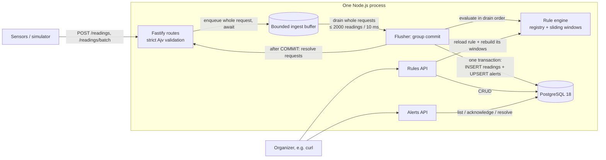
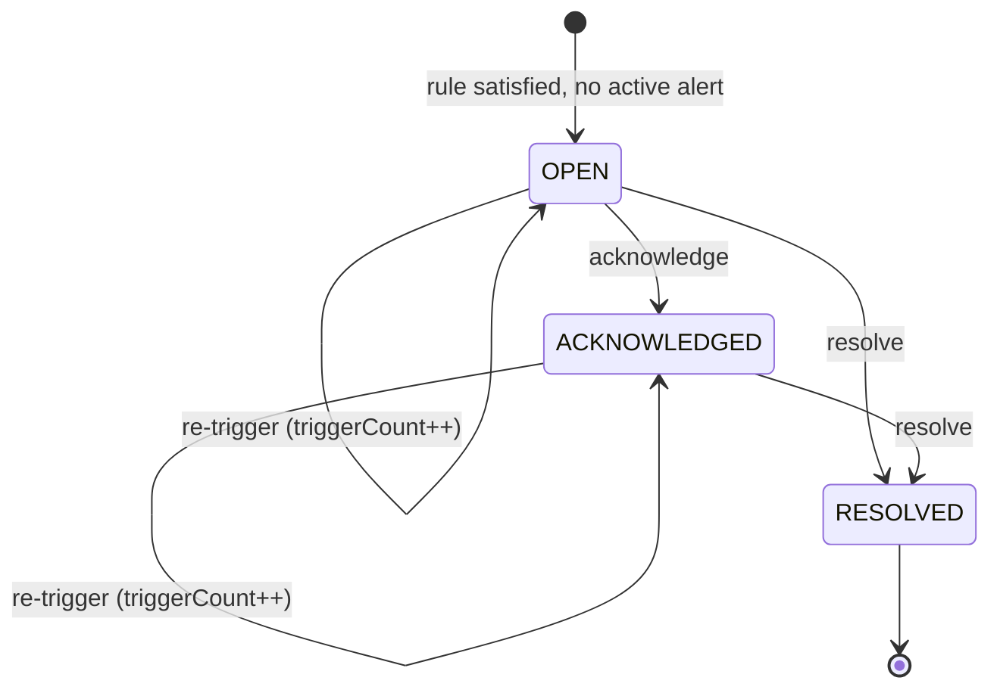

# Architecture

How the Campus Sensor Monitoring & Alerts service works, and the throughput and reliability trade-offs behind it. Requirement IDs (FR-*, NFR-*) refer to [`specs.md`](../specs.md). The original design reasoning is in [`design.md`](../design.md). Measured performance is in [`LOAD_TEST_REPORT.md`](LOAD_TEST_REPORT.md).

## 1. What the service does

The service:
- ingests sensor readings, singly or in batches, and is built for bursts of 10,000 readings in one second;
- evaluates organizer-defined alert rules, either per reading or over a sliding time window;
- turns satisfied rules into alerts that organizers can view, acknowledge and resolve.

Following the brief's scope boundary, there is no frontend, authentication, or notification channel.

## 2. Components



| Component | File(s) | Responsibility |
|---|---|---|
| HTTP app | `src/app.ts`, `src/server.ts` | Fastify setup, strict body validation (no type coercion, unknown fields rejected), error format, startup (DB check, pending-migration check, rule load, window warm-up), graceful shutdown |
| Ingest routes | `src/ingest/routes.ts`, `schemas.ts` | Validate readings: whole body for singles, each item for batches. Batches are partially accepted (FR-2.2) |
| Ingest buffer | `src/ingest/buffer.ts` | Bounded FIFO of *whole requests*; all-or-nothing admission, so a full buffer gives `503` |
| Flusher | `src/ingest/pipeline.ts` | Group commit: drains many requests per transaction, evaluates them, commits, then replies to each request |
| Commit | `src/ingest/repository.ts` | One transaction: `unnest` bulk insert of readings plus a coalesced alert upsert |
| Rule registry | `src/rules/registry.ts` | In-memory index of enabled rules by metric type |
| Sliding windows | `src/engine/window.ts` | Per (rule, sensor) event-time window: running sum for `avg`, monotonic deques for `min`/`max`, O(1) amortised |
| Evaluator | `src/engine/evaluator.ts` | Applies THRESHOLD and WINDOW rules in timestamp order; coalesces matches per (rule, sensor) |
| Warm-up | `src/engine/warmup.ts` | Rebuilds window state from stored readings, without raising alerts |
| Rules / Alerts APIs | `src/rules/*`, `src/alerts/*` | Create/edit/enable/disable rules; view/acknowledge/resolve alerts |
| Simulator | `simulator/*` | `pnpm sim`: continuous or burst traffic with normal / spike / drift patterns |
| Load test | `loadtest/*` | `pnpm loadtest`: harness, rule seed, in-server probe, report generator |

## 3. Data model

Three tables, created by `src/db/migrations/001_init.sql`:

| Table | Key points |
|---|---|
| `readings` | `sensor_id`, `type`, `value`, `recorded_at` (UTC), `received_at`. Index `(type, sensor_id, recorded_at)` serves window warm-up. No uniqueness constraint, so duplicates are stored as sent (FR-3.4) |
| `rules` | `kind` (`THRESHOLD`/`WINDOW`), `type`, `operator` (`gt`/`gte`/`lt`/`lte`), `threshold`, `aggregation` (`avg`/`min`/`max`), `window_seconds`, `enabled`. CHECK constraints keep window fields consistent with `kind` |
| `alerts` | `rule_id`, `sensor_id`, `status`, first/last trigger value and time, `trigger_count`, window bounds, `acknowledged_at`, `resolved_at`. A **partial unique index** `(rule_id, sensor_id) WHERE status <> 'RESOLVED'` allows at most one active alert per rule and sensor (FR-7.3) |

Ids are PostgreSQL 18's built-in `uuidv7()`. They are time-ordered, so "newest first" is `ORDER BY id DESC`, and the pagination cursor is simply the last id.

## 4. Ingestion data flow: reply-after-commit

```mermaid
sequenceDiagram
  participant C as Client
  participant R as Route
  participant B as Buffer
  participant F as Flusher
  participant E as Rule engine
  participant DB as PostgreSQL

  C->>R: POST /readings/batch (≤1000)
  R->>R: validate each item
  R->>B: push(valid readings, resolve, reject)
  alt buffer full
    R-->>C: 503 Retry-After: 1 (nothing stored)
  end
  Note over B,F: 2000 readings queued or 10 ms elapsed
  F->>B: drain whole requests (≤ 2000 readings)
  F->>E: evaluate (sorted by timestamp)
  E-->>F: coalesced alert upserts
  F->>DB: BEGIN; INSERT readings; UPSERT alerts; COMMIT
  alt commit ok
    F-->>R: resolve
    R-->>C: 202 {accepted, rejected}
  else still failing after ~5 s of retries
    F-->>R: reject
    R-->>C: 503 Retry-After: 1 (nothing stored)
    F->>E: rebuild affected windows from DB
  end
```

Key properties:
- **A `202` means stored.** The reading and its alert changes are committed before the reply (NFR-3).
- **Requests are never split.** All readings of one request land in the same transaction, so a request fully succeeds (`202`) or fully fails (`503`, safe to retry).
- **Throughput comes from batching:** one transaction serves many requests. Up to 3 transactions overlap (`FLUSH_CONCURRENCY`).
- **Evaluation happens at drain time, in order,** so window state always sees batches in sequence even though their commits overlap. A failed commit is retried with the *same* prepared rows, so nothing is evaluated twice.

## 5. Rule evaluation

- **THRESHOLD:** `value <operator> threshold` for every reading of the rule's metric type.
- **WINDOW:** each reading at time *t* updates that sensor's window `(t − windowSeconds, t]` for the rule. Then `avg|min|max <operator> threshold`. Windows use **event time**, the reading's own timestamp, not arrival time.
- **Late readings:** a reading older than the newest one seen for that (rule, sensor) is stored and checked by THRESHOLD rules, but it does not enter the window (FR-6.4). Readings inside one batch are sorted first, so out-of-order arrival within a batch is fine.
- **History:** windows are rebuilt from the database at startup and whenever a WINDOW rule is created, edited or enabled. History is anchored at each sensor's newest stored reading. So a new rule immediately considers the last ten minutes of data, and a restart loses nothing (FR-6.3).
- **Rule changes** apply to the next reading committed after the API call returns (FR-4.5). They never modify existing alerts (FR-4.6).

## 6. Alert lifecycle and de-duplication



- **De-duplication:** while an alert for a (rule, sensor) is active, further matches update it (`triggerCount`, `lastValue`, `lastTriggeredAt`) instead of creating duplicates. Every trigger is still recorded, and a 10,000-reading burst can't flood organizers with thousands of alerts. After `RESOLVED`, the next match opens a new alert.
- **Atomic transitions:** acknowledge and resolve are single conditional `UPDATE`s. Repeating a transition returns `200` unchanged. An impossible one (acknowledging a resolved alert) returns `409`. Concurrent requests can't corrupt state.

## 7. Throughput: handling 10,000 readings in one second

| Technique | Effect |
|---|---|
| No per-request database round trip | A request costs parsing + validation + an in-memory enqueue |
| Group commit (≤ 2000 readings per transaction, 3 overlapping) | 10,000 readings ≈ 5–10 transactions |
| `unnest` array parameters | One insert statement per batch regardless of size, no bind-parameter limit |
| Alert coalescing | Alert writes scale with distinct (rule, sensor) matches, not with readings |
| In-memory registry and O(1) windows | Rule evaluation is microseconds per reading, with no queries |
| Explicit backpressure | A bounded buffer turns overload into `503 Retry-After`, not unbounded memory |

**Measured** on a 15 W laptop (Intel Core Ultra 5 125U), with client, server and PostgreSQL on the same machine, 24 rules, and durability on:

| Burst shape | Completion | Meets the targets? |
|---|---|---|
| 10 × 1,000-reading batches | 0.14–0.32 s | every run, ≥ 9× margin |
| 100 × 100-reading batches | 0.19–0.44 s | every run, ≥ 6× margin |
| 10,000 single readings (512 connections) | 0.81–3.39 s | most runs: p99 < 2 s in 6 of 11 validation runs, completion < 3 s in 9 of 11 |

Every run of every shape had zero failed requests and matching database row counts.

The single-reading path is limited by the operating system, not by the application. A CPU profile attributes ~36% of the server's busy time to writing each HTTP response to its socket on Windows, versus ~9% for the application's own logic. Details, tuning sweeps and the profile are in [`LOAD_TEST_REPORT.md`](LOAD_TEST_REPORT.md).

## 8. Reliability guarantees

| Situation | Behaviour |
|---|---|
| Client gets `202` | Reading and alert changes are committed in PostgreSQL (`synchronous_commit = on`) |
| Client gets `503` | Nothing from that request was stored, so retrying is safe |
| Buffer full (overload) | Immediate `503 Retry-After: 1`; memory stays bounded (`BUFFER_CAPACITY`) |
| Database briefly unavailable | Each batch retries with exponential backoff (50 ms → 1 s) for up to `COMMIT_RETRY_BUDGET_MS` (5 s), then `503`. Window state is rebuilt from the DB so never-stored readings don't linger |
| Process crash | Committed data is safe. Requests in flight got no `202`, so clients retry them |
| Graceful shutdown (SIGINT/SIGTERM) | Stops accepting, finishes in-flight requests, drains the buffer, then closes the pool |
| Restart | Rules and window history are reloaded from the database before the server listens. The server refuses to start with pending migrations |

## 9. Trade-offs

| Decision | Chosen | Alternative | Why |
|---|---|---|---|
| When to reply | After commit (group commit) | Reply on enqueue | No accepted reading is ever lost. Costs ~30–40 ms of latency per request; batching keeps throughput |
| Durable buffer | PostgreSQL itself | Redis Streams / Kafka | Redis needs save-to-disk on every write to match this guarantee, and single-broker Kafka leaves data in OS memory. Either adds a second system, and the data must reach PostgreSQL anyway |
| Readings + alerts | One transaction | Evaluate after commit | An alert can't be lost between "reading stored" and "alert written" |
| Overload / outage | `503` with clear semantics | Unbounded queue or silent drop | Bounded memory; clients know exactly when to retry |
| Window state | In memory, warmed from DB | SQL aggregate per reading | O(1) per reading versus a query per reading, which is infeasible at 10k/s. Costs: state belongs to one process |
| Window semantics | Sliding, event time, late readings skipped | Tumbling buckets or watermarks | Simple and deterministic. Rare out-of-order readings don't distort windows |
| De-duplication | One active alert per (rule, sensor) + count | Alert per match | Prevents alert storms while still counting every trigger |
| Duplicate readings | Stored as sent | Unique constraint | Keeps bulk insert fast. A retry after a lost `202` may duplicate one reading |
| Batch validation | Partial acceptance | Reject whole batch | One bad item doesn't block 999 good ones |
| Overlapping commits | 3 | 1 (serial) or more | Measured best: serial leaves PostgreSQL idle, and more transactions queue on hot alert rows |
| Concurrency | One Node.js process | Cluster | Windows need a single owner. One event loop handles ~3–12k single requests/s on the test laptop; batching is ≥ 5× cheaper |

## 10. Scale-out path

Beyond one process, the natural next step is a durable log such as Kafka **partitioned by `sensorId`**:
- The HTTP tier only validates and appends, and acknowledges once the log acknowledges.
- Each consumer owns a set of partitions, so it alone holds those sensors' windows. It writes readings and alerts in batches exactly as the flusher does today.
- Rule changes are broadcast to all consumers.

This keeps the single-owner property for window state while adding throughput and availability.

## 11. Known limitations

- **Window memory grows with reading rate × window length:** every reading is held in each matching window. That's fine for bursts; the load test peaked at 255 MB. For sustained high rates with long windows, readings should be pre-aggregated into per-second buckets per (rule, sensor).
- **Single requests are near the limit of one event loop on low-power hardware:** 10,000 single-reading requests take 0.8–3.4 s on the test laptop and do not always meet the latency target. That's mostly the per-response socket write cost on Windows. Batching or gateway aggregation (≥ 5× margin) is recommended for large fleets.
- **A rule change has a brief gap:** while a WINDOW rule's window is being rebuilt (one query), readings committed in that moment are not in its rebuilt window.
- **No authentication or organizer identity,** as scoped out by the brief. Sensors are trusted and need no registration.
